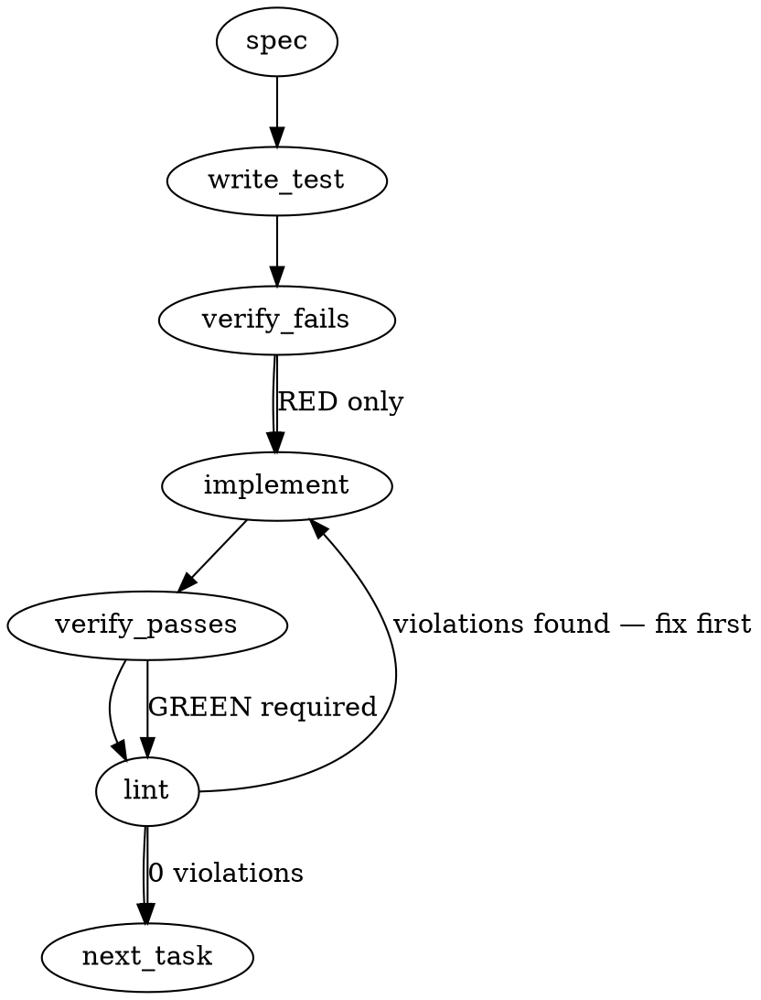

### Problem Statement

In the pre-push hook, `totem review` evaluates uncommitted working-tree modifications instead of the pushed revision range whenever the working tree is dirty. The pre-push hook script and `totem review` invocation must be updated to force the diff source to the pushed commit range (or base-vs-branch range via existing `--push-gate` / explicit diff range options) and record that range in the review verdict artifact.

### Architectural Context

- **Issue #2091 & `DiffForReviewOptions` in `packages/cli/src/git.ts`**: The codebase already introduced `forceBranchVsBase` and explicit `diff` range options to bypass the working-tree fallback chain.
- **Lesson — Strict Tier Hooks (`mmnto-ai/totem#2926`)**: Managed pre-push hooks arm strict tier when run by agents (`CLAUDECODE`, `CLAUDE_CODE_ENTRYPOINT`). Tests spawning rendered hooks must scrub these environment variables to avoid accidentally executing strict-tier logic in standard-tier test contexts.
- **Lesson — Allowlist child-process calls (`packages/pack-agent-security/test/repo-sweep.test.ts`)**: If any new child-process calls are added to CLI files tracked by security sweep rules, update the pinned call-site count and justification in the sweep test.
- **Lesson — Review Lane Filter Absent Files**: Lane reviews read diffs against file payload filters. Passing an accurate git range ensures review payloads accurately reflect committed code rather than uncommitted artifacts.

### Files to Examine

1. `packages/cli/src/git.ts` — Definition of `DiffForReviewOptions`, diff detection order, and git range resolution helpers (`getDiffForReview`).
2. `packages/cli/src/commands/review.ts` — Review CLI command entrypoint; inspect how flags (e.g. `--diff`, `--push-gate`, or `--gate`) pass options down to `getDiffForReview` and how the diff source is logged and stored.
3. `packages/cli/src/hooks.ts` (or `tools/pre-push`, `packages/cli/src/install-hooks.ts`) — The pre-push hook template/render logic where `totem review` is invoked.
4. `packages/cli/test/git.test.ts` / `packages/cli/test/review.test.ts` — Existing test fixtures and harnesses for diff resolution order and review command flags.
5. `packages/cli/test/install-hooks.test.ts` — Tests checking hook generation and pre-push execution.

### Technical Approach & Contracts

1. **Hook Invocations & Range Detection**:
   - The pre-push git hook receives pushed ref specifications over standard input in the format `<local-ref> <local-sha> <remote-ref> <remote-sha>`.
   - When a commit is pushed, the hook knows the range to evaluate (e.g., `<remote-sha>..<local-sha>`, or if remote is 0000.../new branch, resolve against base `origin/<default-branch>...<local-sha>`).
   - The pre-push hook must either pass `--push-gate` / `--diff <range>` directly to `totem review`, matching how `[Lint]` and `[Legs]` compute the pushed branch diff.

2. **Diff Option Data Contract in `packages/cli/src/git.ts`**:
   Ensure `DiffForReviewOptions` supports forcing push scope or explicit ref ranges and that `getDiffForReview` prioritizes them over uncommitted edits:

   ```typescript
   export interface DiffForReviewOptions {
     staged?: boolean;
     diff?: string; // Explicit ref range e.g. "origin/main...HEAD"
     pushGate?: boolean; // Force branch-vs-base regardless of dirty working-tree
     forceBranchVsBase?: boolean;
   }
   ```

3. **Verdict Provenance Contract**:
   When writing the review verdict/artifact (e.g. `ReviewVerdict` or `.totem/review-*.json`), store the resolved diff source metadata:
   ```typescript
   export interface ReviewVerdictArtifact {
     verdict: string;
     diffSource: 'uncommitted' | 'staged' | 'branch-vs-base' | 'range';
     range?: string;
     filesChanged: string[];
     // ... remaining verdict properties
   }
   ```

### Edge Cases & Traps

- **Pushing a New Branch**: `<remote-sha>` is `0000000000000000000000000000000000000000`. The diff range cannot simply be `<remote-sha>..<local-sha>`; it must fall back to `origin/<defaultBranch>...<local-sha>` using `getDefaultBranch()`.
- **Deleting a Remote Branch**: `<local-sha>` is `0000000000000000000000000000000000000000`. In a branch deletion push, the review step must be skipped altogether.
- **Multiple Ref Lines on Stdin**: A single `git push --all` or multi-ref push emits multiple lines on stdin. The hook must either iterate or aggregate the pushed ranges.
- **Environment Scrubbing in Tests**: Per lesson `mmnto-ai/totem#2926`, any integration test exercising the hook must scrub `CLAUDECODE`, `CLAUDE_CODE_ENTRYPOINT`, `CLAUDE_CODE_AGENT`, `CLAUDE_VERSION`, and `CURSOR_TRACE_ID` to prevent unintended strict-tier trigger variations.
- **Security Pack Repo Sweep**: If adding any child-process calls to sweep-monitored files, use `safeExec` where possible, or update `packages/pack-agent-security/test/repo-sweep.test.ts` if direct child_process calls are required.

### Implementation Tasks

- [ ] **Task 1: Add `--diff` / `--push-gate` propagation to `totem review` command**
  - Files to modify: `packages/cli/src/commands/review.ts`, `packages/cli/src/git.ts`
  - Test files: `packages/cli/test/git.test.ts`, `packages/cli/test/review.test.ts`
    > TEST DIRECTIVE: Before implementing, write a failing test named `prioritizes pushGate flag over dirty working tree when resolving diff for review` that proves dirty working tree edits are ignored when `pushGate` or `--diff` is provided.
  - Add or verify command-line flags on `totem review` to accept `--push-gate` and `--diff <range>`.
  - Ensure `getDiffForReview` prioritizes `diff` or `pushGate: true` over uncommitted working-tree edits.
  - Include the evaluated range and diff source in the generated review verdict artifact.
  - Write test -> verify fails -> implement -> verify passes -> `totem lint`.

- [ ] **Task 2: Update pre-push hook template to pass the push range to `totem review`**
  - Files to modify: `packages/cli/src/hooks.ts` (and/or hook template files such as `tools/pre-push`)
  - Test files: `packages/cli/test/install-hooks.test.ts`
    > TOTEM INVARIANT (Since the mmnto-ai/totem#2926 merge): When testing rendered hooks, scrub CLAUDECODE and CLAUDE_CODE_ENTRYPOINT from process.env so tests run consistently across agent and CI environments.
    > TEST DIRECTIVE: Before implementing, write a failing test named `rendered pre-push hook invokes review with push-gate scope and skips branch deletions` that verifies the hook pipes stdin refs and invokes review targeting the pushed range.
  - Parse stdin refs in the pre-push hook: skip execution if `<local-sha>` is all zeros (branch deletion).
  - Pass the determined range or `--push-gate` to the `totem review` invocation inside the shield gate.
  - Write test -> verify fails -> implement -> verify passes -> `totem lint`.

- [ ] **Task 3: Verify security sweep and dormant lint invariants**
  - Files to modify: `packages/pack-agent-security/test/repo-sweep.test.ts` (if child process counts change)
    > TOTEM INVARIANT (Allowlist a new child-process call in a swept file): Any change that adds a spawn call to swept files must carry the allowlist count update in repo-sweep.test.ts.
  - Run `packages/pack-agent-security/test/repo-sweep.test.ts` to ensure no untracked process spawns were introduced.
  - Run full-branch lint checks to confirm clean baseline.
  - Write test (if sweep counts changed) -> verify fails -> implement -> verify passes -> `totem lint`.

### Execution Flow (structural constraint)



### Verification (MANDATORY — do not skip)

Every implementation MUST end with these steps:

1. `totem lint` — deterministic rule check (zero LLM, ~2s). Fixes any violations.
2. `totem review` — supplementary AI lanes over the diff (~18s, advisory). Address critical findings; your team's review discipline decides the review of record.
3. If using MCP, call `verify_execution` to confirm compliance before declaring the task done.

### Test Plan

- **Pre-Push Hook Ref Parsing**:
  - Valid branch push with uncommitted local edits: ensure `totem review` receives `--push-gate` or `--diff <range>` and evaluates only the pushed commits.
  - New branch push (`remote-sha` = 000...): verify range defaults to `origin/<default-branch>...<local-sha>` without crashing.
  - Branch delete push (`local-sha` = 000...): verify the hook terminates early and does not fail or review.
- **Diff Resolution Ordering**:
  - Given a repo with both dirty working-tree files and committed branch differences, verify calling `totem review --push-gate` yields `diffSource: branch-vs-base` and changing files reflect the commit range.
- **Verdict Output**:
  - Assert the resulting verdict JSON artifact records `diffSource` and `range` matching the pushed scope.
