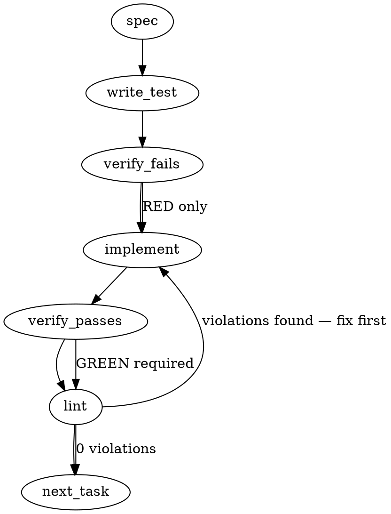

### Problem Statement

Totem's git diff invocations (`getGitDiff`, `getGitBranchDiffResult`, `getGitDiffRange`) inherit ambient git configurations (`diff.external`, `color.ui`/`color.diff`, custom `srcPrefix`/`dstPrefix`, `diff.noprefix`, `diff.mnemonicPrefix`), producing non-standard diff output that breaks unified diff parsing. All git diff invocations must pin standard porcelain flags (`--no-ext-diff`, `--no-color`, `--src-prefix=a/`, `--dst-prefix=b/`) to guarantee deterministic machine-readable diff output.

### Architectural Context

None found in provided context. (Issue references datum from `mmnto-ai/totem#3048` read 4 convergence analysis noting `HEAD_READ_FAILED` and `STAGED_READ_FAILED` under non-standard git prefix configurations).

### Files to Examine

1. `packages/core/src/sys/git.ts` — Primary location of `getGitDiff`, `getGitBranchDiffResult`, `getGitDiffRange`, and shared git execution helpers (_UNVERIFIED ASSUMPTION_ based on issue text).
2. `packages/core/test/sys/git.test.ts` (or equivalent core git unit test suite) — Existing tests for diff fetching and parsing routines (_UNVERIFIED ASSUMPTION_).
3. Callers across packages (`packages/lint`, `packages/review`, legs gate, estimator, shield) invoking `git diff` or `git show` directly or via helpers (_UNVERIFIED ASSUMPTION_).

### Technical Approach & Contracts

1. **Centralize Porcelain Diff Flags:**
   Define a constant array of standard porcelain diff arguments in `packages/core/src/sys/git.ts`:

   ```ts
   export const GIT_PORCELAIN_DIFF_ARGS = [
     '--no-ext-diff',
     '--no-color',
     '--src-prefix=a/',
     '--dst-prefix=b/',
   ] as const;
   ```

   _Alternative considered:_ Passing `-c diff.external= -c color.ui=false ...` as configuration overrides.
   _Decision:_ Use command line flags (`--no-ext-diff --no-color --src-prefix=a/ --dst-prefix=b/`) because flags take precedence over configuration files and match Git's standard internal porcelain script conventions.

2. **Standardize Git Diff Callers:**
   - Update `getGitDiff(mode, cwd)` to append `GIT_PORCELAIN_DIFF_ARGS` when invoking `safeExec`.
   - Update `getGitBranchDiffResult` and `getGitDiffRange` (and any related helper generating diff output) to include `GIT_PORCELAIN_DIFF_ARGS`.
   - Audit `git show` usages: ensure `--no-color` is applied where commit diffs or unified diffs are produced.
   - Note: Commands utilizing `--name-only -z` (e.g., file-list readers) do not generate patch hunks or prefixes, but should still include `--no-ext-diff` to avoid external tool interception.

3. **Data Contract / Signature Invariants:**
   No breaking changes to public TypeScript function signatures. Internal arg construction must guarantee `GIT_PORCELAIN_DIFF_ARGS` is prepended to user-supplied pathspec or revision arguments (to prevent pathspec parsing ambiguity with `--`).

### Edge Cases & Traps

- **Argument Order vs Pathspec Separator (`--`):** In `git diff <args> -- <paths>`, flags like `--no-ext-diff` MUST appear before the `--` delimiter, or git will treat them as path arguments.
- **`git show` vs `git diff` Differences:** `git show` does not accept `--src-prefix` / `--dst-prefix` in older git versions unless patch generation is active; for `git show`, verify whether `--no-color` and `--no-ext-diff` are sufficient or if prefixes are needed.
- **Repository-Level vs CLI Precedence:** Verify whether `git -c diff.noprefix=false diff` is needed if any git versions override `--src-prefix` when `diff.noprefix=true` is set in gitconfig. (Per Git documentation, explicit CLI flags `--src-prefix=a/ --dst-prefix=b/` override `diff.noprefix`).
- **Submodule / Nested Worktree Paths:** Ensuring `--src-prefix=a/` and `--dst-prefix=b/` does not break path resolution when running from subdirectories; `cwd` passed to `safeExec` must remain aligned with git root resolution.

### Implementation Tasks

- [ ] **Task 1: Define shared porcelain diff arguments and unit tests**
  - Files to modify: `packages/core/src/sys/git.ts` (_UNVERIFIED ASSUMPTION_)
  - Files to update: `packages/core/test/sys/git.test.ts` (_UNVERIFIED ASSUMPTION_)
    > TEST DIRECTIVE: Before implementing, write a failing test named `getGitDiff includes porcelain flags --no-ext-diff, --no-color, --src-prefix=a/, --dst-prefix=b/` proving the invocation fails when user config overrides diff behavior.
  - Export `GIT_PORCELAIN_DIFF_ARGS = ['--no-ext-diff', '--no-color', '--src-prefix=a/', '--dst-prefix=b/']`.
  - Write test (or update existing) → verify fails → implement → verify passes → lint.

- [ ] **Task 2: Inject porcelain flags into `getGitDiff`, `getGitBranchDiffResult`, and `getGitDiffRange`**
  - Files to modify: `packages/core/src/sys/git.ts`
  - Files to update: `packages/core/test/sys/git.test.ts`
    > TEST DIRECTIVE: Before implementing, write a failing test named `parses unified diff correctly under non-standard git config (diff.external, color.ui=always, diff.noprefix=true)` using simulated git configurations.
  - Update `getGitDiff`, `getGitBranchDiffResult`, and `getGitDiffRange` to incorporate `GIT_PORCELAIN_DIFF_ARGS` prior to any `--` path separator.
  - Write test (or update existing) → verify fails → implement → verify passes → lint.

- [ ] **Task 3: Audit and secure additional `git diff` / `git show` invocations across core/lint/review**
  - Files to modify: Any audited callers in `packages/core`, `packages/lint`, `packages/review`
  - Files to update: Associated unit tests
    > TEST DIRECTIVE: Before implementing, write a failing test named `git diff callers prevent external diff invocation when diff.external is set in environment`.
  - Inspect references to `safeExec('git', ['diff', ...])` or `safeExec('git', ['show', ...])` in estimator, shield, and legs gate.
  - Ensure all diff/show executions parsing output include `--no-ext-diff` and `--no-color`.
  - Write test (or update existing) → verify fails → implement → verify passes → lint.

### Execution Flow (structural constraint)



### Verification (MANDATORY — do not skip)

Every implementation MUST end with these steps:

1. `totem lint` — deterministic rule check (zero LLM, ~2s). Fixes any violations.
2. `totem review` — supplementary AI lanes over the diff (~18s, advisory). Address critical findings; your team's review discipline decides the review of record.
3. If using MCP, call `verify_execution` to confirm compliance before declaring the task done.

### Test Plan

- **Diff Flag Emission Test:** Assert that `safeExec` calls for git diff operations include `--no-ext-diff`, `--no-color`, `--src-prefix=a/`, and `--dst-prefix=b/` in that order preceding revisions or pathspecs.
- **External Diff Bypass Test:** In an integration test with a temporary git repo, set `git config diff.external "sh -c 'echo custom-diff'"` and assert `getGitDiff` returns standard unified diff output instead of `custom-diff`.
- **Forced Color Test:** Set `git config color.diff always` and `git config color.ui always`, generate changes, and assert that the parsed changed files and hunks have length > 0 and contain no ANSI terminal escape codes.
- **Prefix Disruption Test:** Set `git config diff.noprefix true`, `git config diff.srcPrefix x/`, `git config diff.dstPrefix y/`, and `git config diff.mnemonicPrefix true`. Assert that `extractChangedFiles` and diff parsers correctly identify repository relative paths starting with the standard prefixes `a/` and `b/`.

## Implementation Design

Drafted 2026-11-02 after measuring each configuration on this machine's git 2.56.0 in a throwaway repository (two commits, a top-level directory named `b`): with `diff.external` set, `git diff` prints the external tool's output and `git diff --no-ext-diff` prints the patch; `--name-only`, `--name-status`, `git diff -z --name-only` and `git log -p` print untouched by the external tool (git runs an external diff for `git log` only under `--ext-diff`). With `color.ui always`, the patch, `--stat` and `git log -p` carry escape sequences and `--no-color` removes every one; `--name-only`, `--name-status`, `--numstat` and `--shortstat` carry none. With `diff.noprefix true` the header of a file under the top-level `b` directory reads `diff --git b/x.ts b/x.ts`, and `--src-prefix=a/ --dst-prefix=b/` restores `a/b/x.ts b/b/x.ts`; with `diff.dstPrefix y/` or `diff.mnemonicPrefix true` the staged scope's `+++ i/<path>` becomes `+++ b/<path>` under the explicit prefixes, and a commit range keeps `a/` and `b/` either way. The flags win over every configuration tried, which is what git's own porcelain scripts rely on.

### Scope

Every patch- or stat-producing `git diff` the three packages spawn, and the two `git log -p` spawns, carry one shared argument list, `GIT_DIFF_PORCELAIN_ARGS` (first cut `--no-ext-diff --no-color --src-prefix=a/ --dst-prefix=b/`; widened after the first falsification read and settled at seven after the second, see the folds below), exported from core's `sys/git.ts` and through `@mmnto/totem`, placed directly after the subcommand and before any ref, flag or `--` pathspec separator; a census test over the three packages' sources refuses such a spawn without it, exempting the list forms (`--name-only`, `--name-status`, `--numstat`, `--shortstat`) by their flag, since each was measured untouched by every setting; and behavioral tests set each configuration in a temporary repository and assert the parsed output is the porcelain one. Not in scope: `git show <ref>:<path>` blob reads and `git log --format` metadata reads (no diff is produced, nothing to pin); a `-c` configuration-override form (flags are what git's own scripts use and they override every config tried). The diff parser was first out of scope and gained one change on the first falsification read, counting an empty line inside a hunk as context (`diff.suppressBlankEmpty` has no flag); see the folds.

### Data model deltas

- `GIT_DIFF_PORCELAIN_ARGS: readonly string[]` in `packages/core/src/sys/git.ts`, exported from `packages/core/src/index.ts`: seven literal flags (four in the first cut), written once, read by every spawn site; no state. Command modules read it through the cli's `git.ts` re-export (the module that already imports core's git helpers statically and that `doctor.ts` and `install-hooks.ts` already import), because the lint floor's rule `c16cbd890dc398ea` keeps static `@mmnto/totem` value imports out of `packages/cli/src/commands/**`, the barrel pulling LanceDB into every startup; the first cut imported the barrel directly in three command modules and the floor refused it with three errors.
- No type or field changes. Pinned sites: core `getGitDiff`, `getGitDiffStat`, `getGitBranchDiffResult`, `getGitDiffRange`; cli `git.ts` `getDiffBetween`, `commands/verify-lockfile-sync.ts` (the two patch reads, the lockfile's and the package manifests'), `commands/spine-cert-materialize.ts` (which pinned two of the four by hand and keeps its `--end-of-options`), `commands/extract-local.ts` (`git log -p`, twice). Left as they are, exempt by their flag: the list-form callers in `commands/legs.ts` (`--name-only -z`), `commands/lint.ts` (`--name-status`), `commands/doctor-claim-discipline.ts`, `commands/verify-manifest.ts` and `verify-lockfile-sync.ts`'s changed-files read (`--name-only`), core `ingest/file-resolver.ts` (`-z --name-only`), mcp `tools/verify-execution.ts` (`--name-only`), and cli `getShortstat` and `getNameStatus`; each was measured untouched by every setting, so pinning them would add an import to modules that keep every core value import dynamic for nothing the parser can see. The census exempts them by their flag, so a reader can tell the exemption from the rule.

### State lifecycle

None. Each spawn builds its argument array per call as before.

### Failure modes

| Failure                                                                    | Category | Agent-facing surface                                                                                                                                                                                                                                                                                 | Recovery                                                                                                                                               |
| -------------------------------------------------------------------------- | -------- | ---------------------------------------------------------------------------------------------------------------------------------------------------------------------------------------------------------------------------------------------------------------------------------------------------- | ------------------------------------------------------------------------------------------------------------------------------------------------------ |
| A user or repository config sets `diff.external`                           | runtime  | before: the gate reads the tool's output, finds no additions, prints `Diff source` and exits 0, a pushed violation passes; after: the patch is read                                                                                                                                                  | the pin; a test sets the config and asserts additions are parsed                                                                                       |
| `color.ui` or `color.diff` `always`                                        | runtime  | before: headers carry escapes, `Changed files (0)`, PASS, exit 0; after: the plain patch                                                                                                                                                                                                             | the pin; a test asserts no escape sequence survives                                                                                                    |
| `diff.noprefix`, `diff.srcPrefix`, `diff.dstPrefix`, `diff.mnemonicPrefix` | runtime  | before: the `+++` label is not the repository path, so the blob readers raise `HEAD_READ_FAILED` or `STAGED_READ_FAILED` on a path that does not exist and a clean push is blocked; after: `a/` and `b/` on every scope                                                                              | the pin; tests cover the staged scope's `i/` and a top-level directory named `b`                                                                       |
| A future `git diff` spawn is added without the list                        | init     | the census test fails naming the file and line                                                                                                                                                                                                                                                       | add the spread                                                                                                                                         |
| A git older than the flags                                                 | init     | `--no-ext-diff` (1.5), `--no-color` (1.5), `--src-prefix`/`--dst-prefix` (1.5.6), `--no-textconv` (1.6.1), `--submodule` (1.7.0) are old; `--no-relative` arrived with `diff.relative` in 2.28 (2020) and sets the floor; an older git refuses every pinned read loudly with an unknown-option error | none needed at 2.28 or later; the floor is recorded in the changeset                                                                                   |
| A flag placed after `--`                                                   | runtime  | git reads it as a pathspec and the diff is empty                                                                                                                                                                                                                                                     | the list is spread directly after the subcommand at every site; the census checks the position                                                         |
| `diff.relative true` with a subdirectory as the working directory          | runtime  | before: paths lose the directory prefix and every change outside it is dropped; after: repository paths, every change                                                                                                                                                                                | the `--no-relative` pin; a real-git test from the subdirectory                                                                                         |
| a `diff=<driver>` attribute with a `textconv`                              | runtime  | before: the converted text, where the blob readers see the file's bytes, and a failing converter is fatal; after: the bytes                                                                                                                                                                          | the `--no-textconv` pin; a real-git test with a converter                                                                                              |
| `diff.submodule=diff`                                                      | runtime  | before: a submodule's own patch under this repository's headers, so the gate would grade files not in the repository; after: `Subproject commit` lines                                                                                                                                               | the `--submodule=short` pin, git's default format; measured a no-op without a submodule and identical with one by the second read                      |
| `diff.suppressBlankEmpty true` (no flag exists)                            | runtime  | before: an empty context line is an empty string, the parser skips it, every later line number shifts by one and a `totem-ignore-next-line` above a blank suppresses the violation below; after: the parser counts the empty line as context                                                         | the parser change; two unit tests and a real-git test                                                                                                  |
| `diff.context 0`                                                           | runtime  | the unchanged line a `totem-ignore-next-line` sits on is not in the hunk, so clean code fails, a false FAIL naming its file and line                                                                                                                                                                 | disclosed, not pinned: `--unified=3` would cure it but implies `--patch`, which turned the stat read into a patch (the second read's blocking finding) |

### Invariants to lock in via tests

- One real-git case per setting on the reader that meets it: `getGitDiffRange` under `diff.external`, `diff.dstPrefix`/`diff.srcPrefix`, `diff.relative` from a subdirectory, a textconv driver and `diff.suppressBlankEmpty`; `getGitDiff('all')` and `getGitDiffStat` under `color.ui always`; `getGitDiff('staged')` under `diff.mnemonicPrefix`; `getGitBranchDiffResult` under `diff.noprefix` with a top-level `b` directory. Each asserts the porcelain text and the absence of the rewritten text (RED on main: the measured outputs above). `getDiffBetween` and every other pinned site are pinned by their argv assertion, which the one shared constant makes sufficient.
- `getGitDiffStat` under `color.ui always` carries no escape sequence and stays a stat: no `diff --git` header and no added line (RED with a `--unified` pin, which implies `--patch`).
- Every patch- or stat-producing `git diff` spawn in `packages/*/src` (test files excluded) spreads `GIT_DIFF_PORCELAIN_ARGS` as the element after `'diff'`, the two `git log -p` spawns spread it after `'log'`, and a spawn carrying `--name-only`, `--name-status`, `--numstat` or `--shortstat` and no patch or stat spelling is exempt by that flag (the census; RED on main at eleven sites; the detector's own test hands it eighteen lines, sixteen of them git argv, and checks the eleven it must name and the five it must pass).
- The exported list is exactly the seven flags in that order (the contract pin a consumer can read).

### Open questions

- **Question:** pin the list-form callers too, or only the patch and stat producers?
  - **Options:** patch and stat only (smaller diff; the census exempts `--name-only`, `--name-status`, `--numstat`, `--shortstat` by flag); every `git diff` (one rule, no exemption; harmless flags on the list forms, measured).
  - **Recommendation:** patch and stat producers only. The first draft said every `git diff`; it was reversed before the build because the list forms were measured untouched by every setting, and pinning them would add a static core value import to `commands/legs.ts`, `commands/lint.ts`, `commands/doctor-claim-discipline.ts`, `commands/verify-manifest.ts` and mcp `tools/verify-execution.ts`, modules that keep every core value import dynamic, for nothing their parsers can see. The exemption is spelled in the census by flag name, so the rule stays readable.
- **Question:** flags or `-c` overrides (`-c diff.external= -c color.ui=never -c diff.noprefix=false -c diff.mnemonicPrefix=false -c diff.srcPrefix=a/ -c diff.dstPrefix=b/`)?
  - **Options:** flags (what git's porcelain scripts use; four tokens; measured to win); `-c` (six tokens, must name every config that could interfere, including ones not yet known).
  - **Recommendation:** flags.
- **Question:** changeset level?
  - **Options:** patch (a gate correctness fix, no API removed; one new export); minor (a new public constant on `@mmnto/totem`).
  - **Recommendation:** patch, naming the export.

Approval: the operator's standing word of 2026-11-02 to proceed on the recommendations covers these three; each is taken as recommended.

### Folds from the first falsification read (2026-11-02)

The leg read the two-commit branch, named convergence on the pin mechanism for the named settings, and returned 0 blocking, 2 material, 5 minor, 1 question. Each finding was verified against the source it cited before folding; the measurements below are this seat's, on git 2.56.0, in the probe repository.

1. **`diff.suppressBlankEmpty` has no flag** (material). Under it an empty context line is an empty string; `extractAddedLines` counted context only on a leading space, so every later line number shifted by one and a `totem-ignore-next-line` on the line above a blank was read as the line directly above the addition, suppressing a violation it never named. The `-c diff.suppressBlankEmpty=false` override cannot live in the spread list (a `-c` precedes the subcommand), so the fold is in the parser: an empty line inside a hunk is a context line. The differential table is the parser's existing tests (`compiler.test.ts`, which never carries an empty line inside a hunk and is unchanged; the cli shield integration test's fixture does carry one, see the second read's item 3); two new unit tests pin the spaced and suppressed forms to one result and keep empty lines outside a hunk ignored, and a real-git test applies the setting.
2. **The constant's JSDoc described the reversed first draft** (material): it said the list forms carry the list and the census needs no exemption table. Rewritten to the code: list forms unpinned, exempt by flag.
3. **Three more same-class keys with flags** (minor each), each measured by the leg and re-measured here, each folded as a pin that is git's default on a default config: `--no-textconv` (a `diff=<driver>` attribute with `textconv` showed converted text where the blob readers see bytes, and a failing converter made the diff fatal), `--no-relative` (`diff.relative true` with a subdirectory as cwd stripped the prefix and dropped outside changes; the lint command runs from `process.cwd()`), `--unified=3` (`diff.context 0` hid the unchanged line a directive sits on, a false FAIL). The leg's question on `diff.submodule=diff` (which inlines a submodule's patch under this repository's headers) is folded as `--submodule=short`, git's default format, measured a no-op on the probe repository and accepted by `git log`, `--stat` and `--shortstat`; it was not measured against a submodule, which this repository has none of. The eight-flag list was measured byte-identical to the unpinned default on a default config.
4. **The census was narrower than the changeset claimed** (minor): a regex on single-quoted, comma-carrying literals missed `['diff']`, double quotes, the `['-C', dir, 'diff', …]` idiom, a nested `]`, the `--patch`/`-u`/`--stat`/`--cc` spellings on `git log`, and treated `['diff', '--stat', '--numstat']` as exempt though `--stat` is coloured. The scanner now reads array literals with balanced brackets and either quote style, finds the subcommand wherever it sits, treats a stat or patch spelling as a producer whatever else the argv carries, and its self-test hands it thirteen shapes and checks the eight it must name.
5. **The design's invariant overstated the tests** (minor): five readers times five settings read as twenty-five cases where the tests run one reader per setting. Reworded: one real-git case per setting on the reader that meets it, the constant pinned by value, and every call site pinned by its argv assertion, which the shared constant makes sufficient.

A second, scoped read on the fold diff follows, because the parser change rewires a semantics (the leg's own condition for a re-read).

### Folds from the second falsification read (2026-11-02)

The second leg read the fold (`80e7c5d4..bd2e2eda`), named convergence on the parser predicate (correct on every input git can emit: a trailing empty element, blanks between hunks or after a binary notice, combined `@@@` diffs, `git log -p` streams; a CR-only line prints as a space plus CR under `diff.suppressBlankEmpty`, so the predicate never meets it), and withheld convergence on the widened list for one blocking reason, with six minors and one question.

1. **`--unified=3` implies `--patch`** (blocking; git's own option documentation says so). With it the stat read `getGitDiffStat` printed the stat and then the whole patch on a default config, which `totem handoff` writes into a journal's fenced block, and the first fold's "byte-identical" claim was false for that one form; the colour test asserted only the absence of escapes and the file name, so it could not see it. Measured here: the eight-flag `--stat` prints a `diff --git` header where the unpinned prints none; the seven-flag list without `--unified` is byte-identical on the patch, staged, range, `--stat`, `--shortstat`, `--numstat` and `git log -p` forms. Folded: the flag is dropped, the stat test asserts no header and no added line, and `diff.context 0` moves from pinned to disclosed (a false FAIL that names its file and line; a `--unified` pin cannot ride in a list a stat reader shares).
2. **The design text was stale** (minor): the first fold edited only the Scope paragraph and appended its section, leaving "four literal flags", "exactly the four flags", the five-by-five invariant, the parser in the negative scope, no failure-mode rows for the new settings and a wrong shape count. Each line is corrected above.
3. **One existing fixture does carry an empty line inside a hunk** (minor): the cli shield integration test's hand-written diff has a blank context line whose space was stripped; the fold moves its additions' line numbers by one to the true values (line 2 of that file is blank), and the test asserts headings only, so it stays green. The first fold's sentence that no existing test carried such a line is corrected: the parser's differential table is the compiler tests (unchanged) plus this one fixture (numbers move to the correct values, unasserted).
4. **The parser's `insideHunk` guard was unobservable** (minor): every empty line outside a hunk is followed by a header that resets the count, so a guarded and an unguarded predicate give identical output on every input; the guard is removed and the unit test is retitled to the property it can observe (a header resets the count).
5. **Two assertions were weaker than they read** (minor): the textconv fixture's `abce` mapped to `ABCe`, so its negative assertion could never fail; the fixture now adds a line the converter maps whole (`+abcd` against `+ABCD`). The `diff.context 0` test's hunk-header regex also passed for one or two lines of context; the test is gone with the flag.
6. **The census scanner had no regex-literal handling and missed four spellings** (minor): a regex literal carrying a quote desynchronised it for the rest of the file; it now closes a `'` or `"` string at the end of its line (such a string cannot span one), so the effect ends with the line, and `--stat=<n>`, `-U<n>`/`--unified`, and `--word-diff` count as patch or stat spellings whatever else rides with them. Its self-test gains a regex line followed by an unpinned diff, and a list flag beside `-U3`. Still unread, disclosed in the changeset: an argv whose subcommand is a variable, and `show`, `diff-tree` or `stash show`, none of which the tree spawns for a patch.
7. **"Seven of the values are git's own defaults" was wrong by one** (minor): `--ext-diff` is allowed by default for `git diff`, so `--no-ext-diff` is an opt-out in the same class as `--no-textconv`; the JSDoc and the changeset now say five defaults and two opt-outs. "`diff.context` below 3 hides the directive line" overstated: only 0 does.
8. **`--no-relative` arrived in git 2.28** (question, answered from git's release notes): that is the floor the list sets, recorded in the version row and the changeset; an older git fails loudly with an unknown-option error. Totem declares no git floor today.

A third read, scoped to the stat pin change and the stat assertion, follows.
