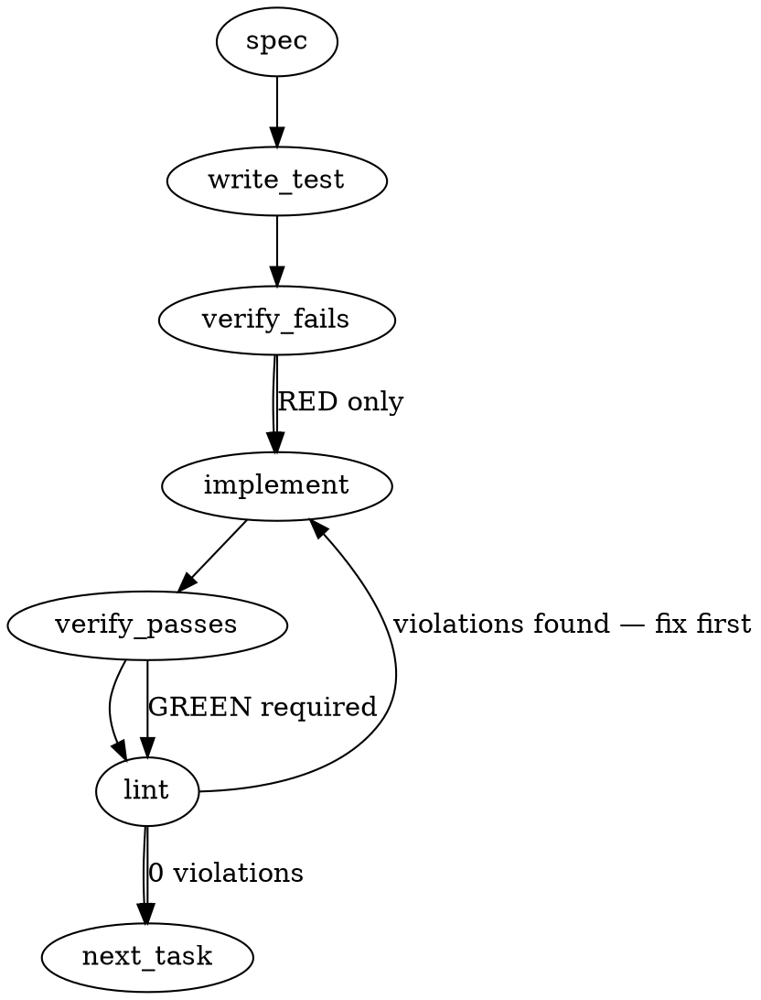

### Problem Statement

Running hook installation (`tools/install-hooks.js` during `prepare` or `totem hook install`) from a linked git worktree overwrites the repository's shared `$GIT_COMMON_DIR/hooks` with templates from that worktree's branch, silently degrading hooks across all checkouts. Hook installation must detect linked worktrees, skip rewriting shared hooks by default unless `--force` is supplied, and `totem doctor` must report the executing checkout's baseline in its `Git Hooks` row.

### Architectural Context

None found in provided context.

### Files to Examine

1. `tools/install-hooks.js` — The standalone repository `prepare` script that detects git directories and copies `tools/pre-commit`, `tools/pre-push`, and `tools/post-merge`.
2. `packages/cli/src/commands/install-hooks.ts` — CLI implementation containing `resolveHooksDir`, `checkHooksInstalled`, and the `hook install` command options and actions.
3. `packages/cli/src/commands/doctor.ts` — Implements `totem doctor` checks, specifically the `Git Hooks` diagnostic row that evaluates installed hooks against canonical templates.
4. `packages/cli/src/commands/__tests__/install-hooks.test.ts` — Unit tests for CLI hook installation and resolution logic.
5. `packages/cli/src/commands/__tests__/doctor.test.ts` — Unit tests for the doctor command output formatting and hook validation.

### Technical Approach & Contracts

#### Worktree Detection Strategy

A git worktree is linked (secondary) if:

1. `git rev-parse --git-dir` resolves to a path distinct from `git rev-parse --git-common-dir` (canonical git mechanism).
2. Fallback without git binary or probe failure: `.git` at `gitRoot` is a file containing `gitdir: <path>` rather than a directory.

In both `tools/install-hooks.js` and `packages/cli/src/commands/install-hooks.ts`:

- Define helper `isLinkedWorktree(gitRoot: string): { isLinked: boolean; commonDir?: string; gitDir?: string }`.
- When `isLinked` is true and `force` is false:
  - Skip copying / overwriting hooks.
  - Print informative output: `Git hooks are shared across worktrees (owned by main worktree at <path>). Skipping install (run with --force to overwrite).`
  - Exit code `0` (so `pnpm install` / `prepare` does not abort).
- When `force` is true or `isLinked` is false:
  - Proceed with standard hook copy/installation.

#### CLI & Doctor Data Contracts

```typescript
export interface WorktreeDetectionResult {
  isLinked: boolean;
  gitDir: string | null;
  commonDir: string | null;
  mainCheckoutRoot: string | null;
}

export interface InstallHooksOptions {
  force?: boolean;
  check?: boolean;
}

export interface GitHooksDoctorResult {
  status: 'ok' | 'warn' | 'error';
  message: string;
  baselineCheckout: string; // Describes the running build / checkout path
  installedRevision?: string;
}
```

#### Doctor Output Update

In `packages/cli/src/commands/doctor.ts`:

- Update the `Git Hooks` row renderer to append or display the baseline checkout origin (e.g., `Git Hooks: OK (canonical from <relative-root-or-commit>)` or `checked against current checkout: <cwd>`).

### Edge Cases & Traps

- **Cold-Start Bundle Traps:** `packages/cli/src/commands/install-hooks.ts` avoids heavy barrel imports to preserve CLI cold-start speed; use `node:child_process.spawnSync` or lightweight raw probes directly in line with existing file idioms rather than pulling in heavy async modules.
- **`tools/install-hooks.js` Self-Containment:** `tools/install-hooks.js` runs in vanilla Node during `npm/pnpm prepare` before dependencies may be fully compiled or linked. It cannot import `@mmnto/totem` or TS packages; it must use standard `node:fs`, `node:path`, and `node:child_process`.
- **Windows Path Separators:** `git rev-parse` returns forward slashes (`/`), while Node `path.resolve` on Windows uses backslashes (`\`). Paths must be normalized (e.g. `path.resolve(path.normalize(...))`) before comparing `gitDir` and `commonDir`.
- **Submodules vs Linked Worktrees:** In a git submodule, `.git` is also a file (`gitdir: ...`). However, `git rev-parse --git-common-dir` inside a submodule points to `.git/modules/<name>`, matching `--git-dir` for that submodule. Do not treat submodules as linked worktrees if `git-dir` and `git-common-dir` match.
- **Preserved File Timestamps (`copyFileSync`):** When `--force` is applied or main worktree writes, update the hook file's `mtime` and `atime` via `fs.utimesSync` to the current time so modification time reflects install time rather than carrying template mtimes.

### Implementation Tasks

- [ ] **Task 1: Add worktree detection and skip logic to `tools/install-hooks.js`**
  - Files to modify: `tools/install-hooks.js`
  - Files to create/update: `tools/__tests__/install-hooks.test.js` (or project equivalent unit test for tools)
    > TEST DIRECTIVE: Before implementing, write a failing test named `skips hook installation in linked worktree without force flag` that mocks a secondary worktree (`git-dir` != `git-common-dir`) and asserts hooks are not copied and the notice is logged.
  - Implement `detectLinkedWorktree(repoRoot)` using `git rev-parse --git-dir` and `--git-common-dir` with fallback to inspecting if `.git` is a file.
  - Support `--force` argv flag.
  - Skip hook copy when `isLinked === true` and `--force` is not present; update `utimesSync` on write.
  - Run test -> verify passes -> lint.

- [ ] **Task 2: Implement worktree guard in CLI `install-hooks.ts`**
  - Files to modify: `packages/cli/src/commands/install-hooks.ts`
  - Files to update: `packages/cli/src/commands/__tests__/install-hooks.test.ts`
    > TEST DIRECTIVE: Before implementing, write a failing test named `resolveHooksDir or hook install skips in linked worktree unless force option is set` asserting worktree detection prevents hook overwrites unless `{ force: true }`.
  - Add `--force` option to CLI `totem hook install` command definition if not already present.
  - Add worktree detection in `installHooksCommand` (matching the `resolveHooksDir` and raw `spawnSync` idiom).
  - Print explanatory warning when skipping.
  - Run test -> verify passes -> lint.

- [ ] **Task 3: Update `totem doctor` Git Hooks diagnostic row**
  - Files to modify: `packages/cli/src/commands/doctor.ts`
  - Files to update: `packages/cli/src/commands/__tests__/doctor.test.ts`
    > TEST DIRECTIVE: Before implementing, write a failing test named `doctor reports canonical baseline checkout in Git Hooks row` asserting the baseline path or worktree indicator is included in doctor output.
  - In `doctor.ts`, adjust the hook verification reporting to disclose the running checkout's baseline location or commit alongside the hook status.
  - Run test -> verify passes -> lint.

### Execution Flow (structural constraint)



### Verification (MANDATORY — do not skip)

Every implementation MUST end with these steps:

1. `totem lint` — deterministic rule check (zero LLM, ~2s). Fixes any violations.
2. `totem review` — supplementary AI lanes over the diff (~18s, advisory). Address critical findings; your team's review discipline decides the review of record.
3. If using MCP, call `verify_execution` to confirm compliance before declaring the task done.

### Test Plan

- **Primary / Main Worktree Install:**
  - Execute hook install in standard repo root (`.git` is directory, `git-dir == git-common-dir`); verify all three hooks (`pre-commit`, `pre-push`, `post-merge`) are written and mtime is updated.
- **Linked Worktree Default (Skip):**
  - Execute hook install in linked worktree (mocked or created via `git worktree add`); verify hooks in `$GIT_COMMON_DIR/hooks` are untouched, process returns exit code 0, and shared-hook notice is logged.
- **Linked Worktree with `--force`:**
  - Execute hook install in linked worktree with `--force`; verify hooks are written despite being in a secondary worktree.
- **Doctor Diagnostic Output:**
  - Run `totem doctor` in a linked worktree with out-of-date hooks; verify the report discloses the running checkout's baseline information instead of reporting an unqualified OK.

## Implementation Design

Triaged past tactical on one line only: the cure touches two installers in two layers (the repository's `tools/install-hooks.js` and the CLI's `installHooksNonInteractive`), one guard and one line each. No new type, state container, error class or cross-cutting concern.

### Scope

A linked worktree (git dir differs from the common dir) skips writing the shared hooks unless forced; the main worktree writes as before. A BARE common repository (the one-worktree-per-branch layout) has no main worktree to own the hooks, so its worktrees write them, read from the common dir's config `core.bare`; without this arm such a user would never get the enforcement hooks installed. Out of scope, recorded on mmnto-ai/totem#3122 as asks 2 and 3: a template version stamp in the managed block, and a doctor row that names the checkout whose build rendered its canonical. The interactive `totem init` installer and `--check` are unchanged.

### Data model deltas

None. One exported pure predicate, `isLinkedWorktree(gitRoot)`, beside `resolveHooksDir`, and one skip-line constant.

### State lifecycle

Per invocation; nothing persists.

### Failure modes

| Failure                                                | Category  | Surface                                                                                                                                         | Recovery                       |
| ------------------------------------------------------ | --------- | ----------------------------------------------------------------------------------------------------------------------------------------------- | ------------------------------ |
| git unavailable or the probe fails                     | runtime   | the offline fallback reads the `.git` pointer and its target's `commondir`; a plain directory or a pointer without `commondir` reads not-linked | as before this change          |
| a submodule checkout                                   | by design | equal dirs and no `commondir`: not linked; the install writes the submodule's own hooks dir                                                     | none needed                    |
| a linked worktree whose user wants this branch's hooks | by design | the skip line names `--force` (CLI) or `TOTEM_HOOKS_FORCE=1` (repository script)                                                                | run with the force             |
| a consumer's `prepare` in a linked worktree            | by design | one line on stderr, exit 0; the per-checkout session hooks are still regenerated                                                                | install from the main worktree |

### Invariants to lock in via tests

- The main worktree writes; a linked worktree without force writes nothing to the shared dir, returns null (exit 0) and prints the line; with force it writes.
- `isLinkedWorktree`: main false, linked true, a pointer without `commondir` false and with `commondir` true (the offline fallback, exercised by a pointer git cannot resolve).
- A worktree of a bare repository: `isLinkedWorktree` true, `commonRepositoryIsBare` true, the install writes into the bare repository's hooks dir without force; the main worktree of a normal repository reads not bare.
- The repository script, copied into a throwaway repository and run there, follows the same three rows.

### Open questions

- **Question:** should an install from a linked worktree write when the worktree's branch is at or ahead of the main worktree's HEAD?
- **Options:** compare revisions (a git read of the other checkout on every install); skip always.
- **Recommendation:** skip always; the main worktree is one install away, and the line says so.
- **Taken:** skip always, on the maintainer's word of 2026-10-26 to handle the issue on the recorded recommendation.
