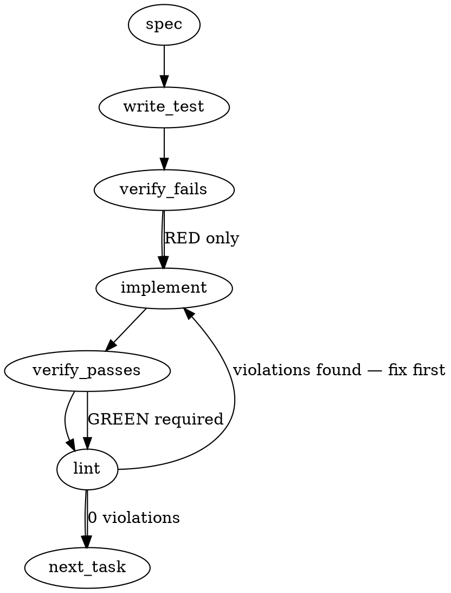

### Problem Statement

Totem's rendered git hook scripts automatically escalate commit/push validation to the strict regime (`totem spec` and legs gate checks) whenever agent environment variables (`CLAUDECODE`, `CURSOR_TRACE_ID`, etc.) are detected, overriding the repository's configured `TOTEM_HOOK_TIER="standard"`. To eliminate first-contact onboarding friction and inconsistent agent coverage, agent tier escalation must be constrained by repository configuration rather than hardcoded environment detection alone.

### Architectural Context

- **mmnto-ai/totem#2706:** Introduced runtime agent detection (`is_agent=1`) in rendered shell hooks to enforce strict spec-evidence gating during automated agent commits.
- **mmnto-ai/totem#3042:** Identified asymmetry where non-Claude/Cursor agents (e.g. Gemini CLI, Codex CLI, Kimi) bypass agent gating because env checks are hardcoded to Claude Code and Cursor.
- **mmnto-ai/totem#3130 (Current):** Documents that implicit strict escalation in standard-tier repositories creates unacceptable friction for new consumers during `totem init`, causing hook uninstallation.
- **Architectural Decision:** Decouple environment detection from mandatory strict enforcement. The pinned `hooks.tier` in repo configuration must govern execution by default. Agent-specific strict escalation in a standard tier repo must require an explicit opt-in (`hooks.agentArming: "strict"`).

### Files to Examine

1. `packages/core/src/config/schema.ts` — Totem configuration schema defining `hooks` settings, tiers, and default arming flags.
2. `packages/core/src/hooks/render.ts` (or `packages/core/src/hooks/installer.ts`) — Hook template rendering logic where `TOTEM_HOOK_TIER` and agent checks are injected into hook scripts.
3. `packages/core/src/hooks/templates/pre-commit.sh` — The pre-commit hook template containing the `is_agent` check and tier conditional gates.
4. `packages/core/src/hooks/templates/pre-push.sh` — The pre-push hook template enforcing legs gating under strict/agent conditions.
5. `packages/cli/src/commands/hook.ts` — CLI command for `totem hook install` accepting `--tier` and `--agent-arming` options.

### Technical Approach & Contracts

#### 1. Configuration Contract (`packages/core/src/config/schema.ts`)

Extend the `HookConfigSchema` to introduce `agentArming`:

```typescript
import { z } from 'zod';

export const HookTierSchema = z.enum(['relaxed', 'standard', 'strict']);
export type HookTier = z.infer<typeof HookTierSchema>;

export const AgentArmingModeSchema = z.enum(['match-tier', 'strict', 'off']);
export type AgentArmingMode = z.infer<typeof AgentArmingModeSchema>;

export const HookConfigSchema = z.object({
  tier: HookTierSchema.default('standard'),
  agentArming: AgentArmingModeSchema.default('match-tier'),
  installedHooks: z.array(z.string()).default(['pre-commit', 'pre-push']),
});
export type HookConfig = z.infer<typeof HookConfigSchema>;
```

#### 2. Hook Script Variables & Shell Logic

The hook templates must render two distinct parameters:

- `TOTEM_HOOK_TIER`: `"relaxed" | "standard" | "strict"`
- `TOTEM_HOOK_AGENT_ARMING`: `"match-tier" | "strict" | "off"`

Template shell logic:

```sh
# Resolved tier resolution
is_agent=0
if [ "$TOTEM_HOOK_AGENT_ARMING" != "off" ]; then
  if [ -n "$CLAUDECODE" ] || [ -n "$CLAUDE_CODE_ENTRYPOINT" ] || [ -n "$CLAUDE_CODE_AGENT" ] || [ -n "$CLAUDE_VERSION" ] || [ -n "$CURSOR_TRACE_ID" ] || [ -n "$AI_AGENT" ]; then
    is_agent=1
  fi
fi

# Determine effective tier
effective_tier="$TOTEM_HOOK_TIER"
if [ "$is_agent" = "1" ] && [ "$TOTEM_HOOK_AGENT_ARMING" = "strict" ]; then
  effective_tier="strict"
fi

# Gate execution on effective_tier
if [ "$effective_tier" = "strict" ]; then
  # Strict gates: anchored totem spec verification, legs gate check
  ...
fi
```

#### 3. Trade-off Analysis & Recommendation

- **Approach A (Implicit agent escalation):** Current behavior. Agents are always strict regardless of repository tier. _Verdict: Rejected. Violates consumer expectations and causes churn during onboarding._
- **Approach B (`agentArming: 'match-tier' | 'strict' | 'off'`, default `'match-tier'`):** Pinned tier rules both human and agent shells by default. Consumers wanting standard behavior get standard behavior. Internal cohort repos pinning `tier: "strict"` retain full strict enforcement without extra flags. Standard-tier repos wanting strict agents can opt in. _Verdict: Recommended._

### Edge Cases & Traps

1. **Existing Cohort Repositories:** Internal repos relying on strict hooks already configure `hooks.tier: "strict"`. They must experience zero change in enforcement.
2. **Subshell Environment Stripping:** Git GUIs or non-interactive shells invoked by agents might clear certain environment variables (`CLAUDECODE`). The shell check must handle missing or empty vars without failing under `set -u`.
3. **Template Drift on Upgrade:** Existing `.git/hooks/*` already rendered on developer machines will retain legacy logic until `totem hook install` or `totem init` is re-run. The CLI must detect stale hook templates via checksum/version metadata during `totem doctor` or `totem hook check`.
4. **Agent Signal Fragmentation (#3042):** Include generic agent signal flags (`AI_AGENT=1`, `AGENT_NAME`) in the agent shell detection to pave the way for other agent runtimes without breaking Claude Code.

### Implementation Tasks

- [ ] **Task 1: Update Configuration Schema for Agent Arming Mode**
  - Files to modify: `packages/core/src/config/schema.ts`
  - Test file: `packages/core/src/config/schema.test.ts`
    > TEST DIRECTIVE: Before implementing, write a failing test named `defaults_hook_agent_arming_to_match_tier` proving schema parses `hooks` without `agentArming` as `match-tier`.
  - Add `AgentArmingModeSchema` (`match-tier`, `strict`, `off`) and attach to `HookConfigSchema`.
  - Verify test fails -> implement -> verify passes -> `totem lint`.

- [ ] **Task 2: Update Hook Template Rendering Logic**
  - Files to modify: `packages/core/src/hooks/render.ts`, `packages/core/src/hooks/templates/pre-commit.sh`, `packages/core/src/hooks/templates/pre-push.sh`
  - Test file: `packages/core/src/hooks/render.test.ts`
    > TEST DIRECTIVE: Before implementing, write a failing test named `renders_hook_script_with_agent_arming_variable_and_effective_tier_resolution` proving template renders `TOTEM_HOOK_AGENT_ARMING` and conditional `effective_tier` logic.
  - Inject `TOTEM_HOOK_AGENT_ARMING` into template parameter interpolation.
  - Replace `if [ "$is_agent" = "1" ] || [ "$TOTEM_HOOK_TIER" = "strict" ];` with effective tier resolution.
  - Verify test fails -> implement -> verify passes -> `totem lint`.

- [ ] **Task 3: Update CLI Hook Installation Options**
  - Files to modify: `packages/cli/src/commands/hook.ts`
  - Test file: `packages/cli/src/commands/hook.test.ts`
    > TEST DIRECTIVE: Before implementing, write a failing test named `hook_install_passes_agent_arming_flag_to_renderer` validating `--agent-arming` CLI flag parsing and config persistence.
  - Add `--agent-arming <mode>` flag to `totem hook install` command.
  - Read `agentArming` from configuration file if flag is omitted.
  - Verify test fails -> implement -> verify passes -> `totem lint`.

- [ ] **Task 4: Integration Shell Execution Test for Agent Scenarios**
  - Files to modify: `packages/core/src/hooks/hook-exec.test.ts`
  - Test file: `packages/core/src/hooks/hook-exec.test.ts`
    > TEST DIRECTIVE: Before implementing, write a failing test named `standard_tier_agent_shell_does_not_trigger_strict_spec_gate` validating that running rendered pre-commit script with `CLAUDECODE=1` and `TOTEM_HOOK_TIER=standard` with `agentArming=match-tier` exits 0 on valid standard commits.
  - Use `safeExec` to run rendered hook script in a mocked environment simulating `CLAUDECODE=1`.
  - Verify test fails -> implement adjustments -> verify passes -> `totem lint`.

### Execution Flow (structural constraint)



### Verification (MANDATORY — do not skip)

Every implementation MUST end with these steps:

1. `totem lint` — deterministic rule check (zero LLM, ~2s). Fixes any violations.
2. `totem review` — supplementary AI lanes over the diff (~18s, advisory). Address critical findings; your team's review discipline decides the review of record.
3. If using MCP, call `verify_execution` to confirm compliance before declaring the task done.

### Test Plan

1. **Config Defaults Test:**
   - Parse empty config object: assert `hooks.tier` is `'standard'` and `hooks.agentArming` is `'match-tier'`.
   - Parse invalid `agentArming` mode: assert schema throws `ZodError`.
2. **Hook Template Output Test:**
   - Render with `tier: standard, agentArming: match-tier`: verify rendered script sets `TOTEM_HOOK_TIER="standard"` and `TOTEM_HOOK_AGENT_ARMING="match-tier"`.
   - Render with `tier: standard, agentArming: strict`: verify rendered script sets `TOTEM_HOOK_AGENT_ARMING="strict"`.
3. **Shell Execution Scenarios (via `safeExec`):**
   - `CLAUDECODE="1"` + `TIER="standard"` + `AGENT_ARMING="match-tier"`: Agent commit does not run strict legs gate or anchored spec check.
   - `CLAUDECODE="1"` + `TIER="standard"` + `AGENT_ARMING="strict"`: Agent commit triggers strict spec verification.
   - `CLAUDECODE=""` + `TIER="strict"` + `AGENT_ARMING="match-tier"`: Human commit triggers strict spec verification.
   - Shell variables unset with `set -u` active: Hook does not fail with unbound variable errors.

## Implementation Design

Drafted 2026-10-28 from source (the generated plan above names files that do not exist: the render lives in `packages/cli/src/commands/install-hooks.ts`, the schema in `packages/core/src/config-schema.ts`). The ruling of record is the operator's comment on mmnto-ai/totem#3130 (2026-10-28T00:16Z): opt-in; one `hooks` key, off by default, rendered beside `TOTEM_HOOK_TIER`; designed in one cut with mmnto-ai/totem#3042; a `totem init` question; a doctor row for repositories with registered seats; the CLAUDE.md sentence and `hook-integration.md` updated.

### Scope

Add `hooks.agentArming: 'off' | 'strict'` (absent means `'off'`), render it into the managed pre-commit and pre-push hooks as `TOTEM_HOOK_AGENT_ARMING`, and make the agent-marker check arm the strict tier only when it reads `strict`; widen the marker table with `TOTEM_SELF_AGENT` (every cohort seat exports it per shell, the mmnto-ai/totem#2629 ruling) and `ANTIGRAVITY_AGENT` (reported by one seat from its own shell on the mmnto-ai/totem#3042 thread), which is this cut's answer to 3042; thread the value through every render site (installers, hook-manager helpers, the silent upgrader, doctor's canonical compare, `doctor --parity`); add a sensor-only `Agent Arming` doctor row; add the `totem init` question with a `--agent-arming` flag; reword the CLAUDE.md reflex clause (REFLEX_VERSION 19); regenerate `tools/pre-commit` and `tools/pre-push`; set the key to `'strict'` in this repository's `totem.config.ts`; update `config-reference.md`, `hook-integration.md`, `enforcement-model.md`. It will NOT add a `totem hook install` flag for arming (the ruling: a tracked file declares it), will NOT make the marker table configurable, will NOT change `hooks.tier` semantics or the legs/shield knobs, will NOT touch the gate-engine hooks, and will NOT fix `totem init --pilot`'s `.ts` no-op (mmnto-ai/totem#3083) beyond sharing the injector with `--strict`.

### Data model deltas

| Delta                                                                     | Holds                                                                                                                                                             | Written by                                                                       | Read by                                                                                                            | Invariants                                                                                                                                                                                                                 |
| ------------------------------------------------------------------------- | ----------------------------------------------------------------------------------------------------------------------------------------------------------------- | -------------------------------------------------------------------------------- | ------------------------------------------------------------------------------------------------------------------ | -------------------------------------------------------------------------------------------------------------------------------------------------------------------------------------------------------------------------- |
| `hooks.agentArming` (config-schema.ts)                                    | `'off'` or `'strict'`, optional, NO Zod default                                                                                                                   | the repo's tracked config (`totem init` question or `--agent-arming`; hand edit) | `resolveHookRenderOptions`, `doctor-parity`, `hooksStaleAgainstCanonical`, the new doctor row                      | optional so ABSENT is distinguishable from `'off'` (the doctor row needs it; the `legsOwed.enforce` precedent); every render site maps ABSENT to `'off'` through one exported constant `DEFAULT_AGENT_ARMING`              |
| `HookRenderOptions.agentArming` (install-hooks.ts)                        | the resolved value                                                                                                                                                | `resolveHookRenderOptions` (config to options); tests                            | `buildPreCommitHook`, `buildPrePushHook` (rendered); `buildHookContent` / `buildPostCheckoutHookContent` ignore it | REQUIRED, per the interface's own rule ("every field is REQUIRED on purpose"): the compiler forces every call site to thread it (18 in install-hooks.ts, 4 in doctor.ts, 4 in doctor-parity.ts, about 180 test call sites) |
| `TOTEM_HOOK_AGENT_ARMING="…"` (hook text)                                 | the rendered literal, line 4, unindented, beside `TOTEM_HOOK_TIER`                                                                                                | the two builders                                                                 | the hook's own agent-detection block                                                                               | only the two literals can be rendered (the TS union); the marker test runs only inside `if [ "$TOTEM_HOOK_AGENT_ARMING" = "strict" ]`; every downstream `is_agent OR tier=strict` test is byte-unchanged                   |
| `AGENT_SHELL_MARKERS` (install-hooks.ts, exported)                        | the env names, ordered: `CLAUDECODE`, `CLAUDE_CODE_ENTRYPOINT`, `CLAUDE_CODE_AGENT`, `CLAUDE_VERSION`, `CURSOR_TRACE_ID`, `TOTEM_SELF_AGENT`, `ANTIGRAVITY_AGENT` | source only                                                                      | `buildAgentDetectionBlock`; the tests' scrub lists; the reflex clause test                                         | fixed table; `GEMINI_API_KEY` stays excluded (humans export it)                                                                                                                                                            |
| doctor `Agent Arming` row                                                 | a `DiagnosticResult`, `gateExempt: true`                                                                                                                          | `checkAgentArming(cwd, loadedConfig)`                                            | the doctor render                                                                                                  | never `fail`; seats = `deriveSeatStatuses(repoRoot).length` (the orchestration dirs, resolved from the real repo root as the Seat Identity row does)                                                                       |
| `initCommand` option `agentArming?: boolean`; `totem init --agent-arming` | the non-interactive "yes"                                                                                                                                         | commander                                                                        | init's config generation                                                                                           | with `--strict` the question is skipped and the key is not written (every shell is strict already)                                                                                                                         |

No reserved keys, no sentinels, no new state container.

### State lifecycle

- **Config key:** persistent, repo-tracked; written once by init or by hand; read at every render (`totem init`, `totem hook install`, the `prepare` wrapper's bare install, the silent upgrader) and every `totem doctor`.
- **Rendered line:** per hook file; created at render; changes ONLY when the hook is re-rendered. A bare install drift-repairs a totem-owned block (`installGitHook` returns `overwritten` or `block-rewritten`), so the next `pnpm install` through a `prepare` wrapper re-renders; a hook with an appended user block takes `totem hook install --force`. The ruled migration rides this: a repository relying on today's arming sets the key BEFORE it re-renders on the cut that carries this.
- **`is_agent`:** per hook run, derived from the rendered literal and the shell's env; no state crosses runs.
- **Doctor rows:** per run, derived; nothing persisted.

### Failure modes

| Failure                                                                                                                     | Category  | Agent-facing surface                                                                                                                                                                                                                                                                                                                                                                                                                                                   | Recovery                                     |
| --------------------------------------------------------------------------------------------------------------------------- | --------- | ---------------------------------------------------------------------------------------------------------------------------------------------------------------------------------------------------------------------------------------------------------------------------------------------------------------------------------------------------------------------------------------------------------------------------------------------------------------------- | -------------------------------------------- |
| Config absent                                                                                                               | init      | silent default: arming `off` (the config-less install is a supported path)                                                                                                                                                                                                                                                                                                                                                                                             | set the key, re-render                       |
| Config resolves but will not load (syntax, a bad `agentArming` value refused by Zod)                                        | init      | the existing LOUD stderr line, extended to say the arming also fell to `'off'`                                                                                                                                                                                                                                                                                                                                                                                         | fix the config, `totem hook install --force` |
| Key set, installed hooks rendered at an older cut (no arming line) or at the other value                                    | runtime   | `doctor` Git Hooks row `warn`: stale, remedy by file shape (`--force` or a bare install); the Agent Arming row names the configured value                                                                                                                                                                                                                                                                                                                              | re-render                                    |
| Cohort repo re-pins to this cut without setting the key                                                                     | runtime   | agent pushes run the pinned tier (standard); the new doctor row WARNS (seats registered, key unset) on every `totem doctor`; the pre-push's own `doctor --strict` no longer runs on that push, so the row's reach is a `totem doctor` run (the SessionStart banner runs `totem describe`, not doctor); the cut-naming mail to strategy names the key (the owed line)                                                                                                   | set `hooks.agentArming: 'strict'`, re-render |
| An agent shell carrying none of the seven markers (a Kimi, Codex or Gemini CLI seat that did not export `TOTEM_SELF_AGENT`) | runtime   | silent: runs the pinned tier. Justified under Tenet 4 only because the shell is indistinguishable from a human's by construction, and the same missing export already makes `totem mail` refuse that seat (the two signals fail together, mmnto-ai/totem#3042 candidate 2); disclosed in `hook-integration.md`                                                                                                                                                         | export `TOTEM_SELF_AGENT` per shell          |
| `TOTEM_SELF_AGENT` at user or machine scope on an operator's terminal (the mmnto-ai/totem#2629 trap)                        | runtime   | the operator's own pushes arm strict when the key is `'strict'`; the Seat Identity row already warns `env-ambient-scope` on win32                                                                                                                                                                                                                                                                                                                                      | launch-shell scope only                      |
| Doctor row's seat read throws (the core import or the repo-root resolver)                                                   | transient | `warn` with the reason, never `fail`; a missing or unreadable orchestration tree is zero seats by core's `readSeatDirs` contract and passes as no seats, the Seat Identity row's reach                                                                                                                                                                                                                                                                                 | fix the tree                                 |
| `totem init --agent-arming` (or the answer yes) on a `.ts` config                                                           | init      | TODAY the `--strict` injector's anchor (a closing brace at end of file) never matches the generated `.ts`, which ends with the brace, a blank line and `export default config;`: a measured silent no-op (the `--pilot` comment, mmnto-ai/totem#2815, mmnto-ai/totem#3083). One injector composes a single `hooks: { tier?, agentArming? }` object anchored on the brace-plus-export tail for `.ts`, append for yaml and toml; the summary line names what was written | none needed                                  |
| Both `--strict` and `--agent-arming`                                                                                        | init      | `--strict` wins; the question is skipped; one `hooks: { tier: 'strict' }` written; init says the arming key is moot under `tier: strict`                                                                                                                                                                                                                                                                                                                               | none needed                                  |
| Existing config at init                                                                                                     | init      | the question is not asked (init's existing-config path touches reflexes and hooks only); the docs say to set the key by hand                                                                                                                                                                                                                                                                                                                                           | none needed                                  |

### Invariants to lock in via tests

- With `agentArming: 'off'` (and with the key absent), a pre-commit AND a pre-push run in a shell carrying EVERY marker take the standard arm: no spec-evidence block, no `doctor --strict`, no review gate, the legs gate in `--advisory` (RED on today's templates).
- With `agentArming: 'strict'`, EACH marker alone arms both hooks, the seven including `TOTEM_SELF_AGENT` and `ANTIGRAVITY_AGENT` (RED for the two new names); with every marker scrubbed, neither hook arms.
- `TOTEM_HOOK_TIER="strict"` arms regardless of the arming value (unchanged behaviour, pinned).
- The arming line is rendered unindented on the line after the tier line, in both hooks and in the hook-manager helpers; `declaredHookTier` still reads the tier (a second assignment line does not confuse it).
- `resolveHookRenderOptions`: absent gives `'off'`; `'strict'` gives `'strict'`; an unloadable config gives `'off'` and the stderr line names the arming default; the global profile config contributes no arming (the same `isGlobalConfigPath` asymmetry as `totemDir`).
- Doctor Git Hooks compare: a hook rendered `off` on a repo configured `strict` (and the reverse) is stale with the shape-specific remedy; the tier remains NOT an axis (a `--strict`-installed hook on a config-less repo still reads clean).
- Doctor Agent Arming row: key unset plus one or more seat dirs gives `warn` naming the seat count and the key; key unset plus zero seats gives `pass`; key set gives `pass` naming the value; `gateExempt: true`; a run from a subdirectory resolves the real orchestration tree; a scan failure is a `warn` with its reason.
- `totem init`: `--agent-arming` lands `hooks: { agentArming: 'strict' }` inside the config object for `.ts`, yaml and toml (RED today for `.ts`); `--strict` lands on `.ts` (RED today); `--strict` plus `--agent-arming` writes one `hooks` object with the tier only; non-interactive takes `off` and logs the default; the prompt's decision is one exported function (`resolveInitHooksKeys`) driven with a fake readline: `y` and `yes` declare the key, `n` and an empty answer declare none, the flags and `--bare` never prompt.
- `AI_PROMPT_BLOCK` names `hooks.agentArming`, the default `off`, `totem hook install --force`, `TOTEM_SELF_AGENT` and the Claude Code variables, and no longer says a Claude Code or Cursor seat "gets automatically"; `REFLEX_VERSION` is 19.
- `tools/pre-commit` and `tools/pre-push` are byte-equal to the builders at `{ tier: 'standard', agentArming: 'strict', totemDir: '.totem', fallbackCmd }`; `totem.config.ts` carries `hooks.agentArming: 'strict'`.
- `doctor --parity`'s canonical carries the configured arming (a pinned fixture at `off` and one at `strict`).

### Open questions

- **Question:** Does the marker table take `TOTEM_SELF_AGENT` and `ANTIGRAVITY_AGENT` in this cut, closing mmnto-ai/totem#3042 as ruled "one design answers both"?
  - **Options:** (a) yes, the fixed table grows by the two measured names: `TOTEM_SELF_AGENT` reaches every cohort seat (Kimi, Codex, Gemini CLI export no vehicle variable, four measurements), `ANTIGRAVITY_AGENT` is the one vehicle variable measured; (b) keep the five and open a configurable `hooks.agentArming.markers` list later (an env-NAME list rendered into `sh` needs its own renderability guard, like `totemDir`); (c) both now.
  - **Recommendation:** (a). File (b) as a follow-up only if a consumer asks; the fixed table is one tested place.
- **Question:** `'off' | 'strict'` enum or a boolean?
  - **Options:** the enum renders literally and self-describes in a tracked file (`agentArming: 'strict'` reads as "agents get strict") and leaves room for a `'pilot'` arm later; a boolean is shorter.
  - **Recommendation:** the enum.
- **Question:** Changeset level?
  - **Options:** `minor` for `@mmnto/cli` and `@mmnto/totem` (a new config key and a changed enforcement default; the 2.17.0 precedent was a new gate event; the packages are a `fixed` group so every package moves together); `patch`.
  - **Recommendation:** `minor`, so the cut is 2.18.0 and the re-pin mail names a minor.
- **Question:** Fix `totem init --strict`'s `.ts` no-op while writing the shared injector?
  - **Options:** yes (one injector, both keys, disclosed in the changeset); no (leave `--strict` as measured and give the new key alone the new anchor, two code paths for one object).
  - **Recommendation:** yes; `--pilot` stays on mmnto-ai/totem#3083.

### Amendment (2026-10-29, the falsification leg's F1, the operator's word "Handle F1 using your recs")

The Scope line "will NOT change `hooks.tier` semantics" is amended by one line: `hooks.tier` loses its schema default (`.default('standard')` becomes `.optional()`). Measured before the fold: a `hooks` block carrying only `agentArming` parsed with `tier: 'standard'`, `resolveHookRenderOptions` read that as a pin (`tierPinned: true`), `tierForHook` therefore ignored the installed hook's declared tier, and a bare re-render downgraded a `--strict`-installed hook to standard with nothing saying so — the mmnto-ai/totem#2753 downgrade, reached through the key this build adds, the init question and the doctor row's remedy. The mechanism predates this build (a `legsOwed`-only block, every cohort config's shape, did the same). After the fold only a DECLARED tier pins; every reader (`resolveHookRenderOptions`, doctor's compare, parity) already applied `'standard'` for an absent tier and is unchanged; the exported `TotemConfig` type carries `hooks.tier` as optional. Differential table, config shape × installed tier, old → new render on a bare re-install: no config × strict → strict → strict (unchanged); `hooks: {}` or arming-only or legsOwed-only × strict → standard → strict (the fold); the same shapes × standard → standard → standard; `hooks: { tier: 'standard' }` × strict → standard → standard (a declared tier pins, unchanged); `hooks: { tier: 'strict' }` × standard → strict → strict (unchanged); an explicit `--standard` flag × strict → standard → standard (unchanged). Pinned by: the core schema test (absent tier for the four tier-less shapes, kept for a declared one, an invalid value refused), the resolver test (`tierPinned` undefined for arming-only and legsOwed-only blocks, `true` for a declared `standard`), and the installer test (a `--strict` install survives a bare re-render under an arming-only and a legsOwed-only config and gains the arming; a declared `standard` still downgrades it).
