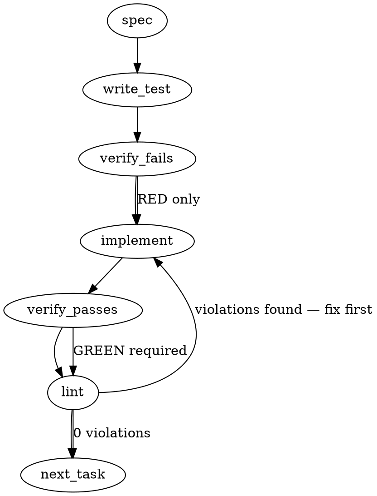

### Problem Statement

Totem's core workspace packages (`@mmnto/core`, `@mmnto/cli`, `@mmnto/mcp`) pin `"zod": "^3.24.0"`, pulling vulnerable `zod@3.25.76` (GHSA-mrhx-c7xc-m3w5 / CVE-2023-54404 DoS via unconstrained array issue accumulation) into all downstream lockfiles. Upgrading workspace dependencies to `zod ^4.6.6` resolves the vulnerability while requiring migration of v3-to-v4 breaking API changes (e.g., `ZodError.issues` vs `ZodError.errors`, schema transformations, and peer dependency handling for `openai`).

### Architectural Context

- **Key security audit findings (Lesson — Key security audit findings and acceptable risks):** The v1.3.1 audit explicitly hardened MCP search parameters using Zod (e.g., `max_results` capped via `.max(100)` to prevent memory exhaustion). Upgraded Zod 4 schemas must strictly maintain these bounds across all tool contracts.
- **Shared Helpers Contract (`readJsonSafe`):** The shared helper in `@mmnto/totem` accepts `ZodSchema<T>`. Moving to Zod 4 modifies the underlying `ZodType` / `ZodSchema` definitions, which cascades to all configuration and manifest parsing across core and CLI.
- **OpenAI SDK Interoperability:** `openai@^4.77.0` specifies `zod ^3.23.8` as an optional peer dependency for structured outputs (`zodResponseFormat`). If Totem relies on raw OpenAI zod helpers, it must use Zod 4 compatibility adapters or bypass `zodResponseFormat` in favor of standard JSON schema objects generated via `zod-to-json-schema` (which supports v4).

### Files to Examine

1. `packages/core/package.json` — Base zod dependency declaration and version constraints.
2. `packages/cli/package.json` — CLI dependency declarations (`zod`, `openai`, `@anthropic-ai/sdk`).
3. `packages/mcp/package.json` — MCP dependency declarations (`zod`, `@modelcontextprotocol/sdk`).
4. `package.json` (root) — Monorepo `pnpm.overrides`, root dependencies, and package resolution settings.
5. `packages/core/src/exporter.ts` — Zod schema parsing and error handling for manifests and exports.
6. `packages/cli/src/commands/search.ts` — Input validation schemas (`ContentTypeSchema`, query limits).
7. `packages/mcp/src/index.ts` (or tools definitions) — MCP tool input schemas, particularly `max_results` and tool payload bounds.
8. `packages/core/src/parity-manifest.ts` — Data models and schema definitions interacting with configuration parsing.

### Technical Approach & Contracts

#### Approach Comparison & Trade-Offs

- **Option A: Monorepo-wide Zod 4 Upgrade (`^4.6.6`) with `pnpm.overrides` for `openai` optional peer warning.**
  - _Pros:_ Completely eliminates CVE-2023-54404 across all consumers and monorepo packages. Clean AST/type environment.
  - _Cons:_ `openai@^4.77.0` emits optional peer dependency warnings during install unless overridden or updated.
  - _Recommendation:_ **Adopt Option A.** Verify whether Totem imports `openai/helpers/zod`. If not, the optional peer warning is inert and suppressed via root `package.json` `pnpm.peerDependencyRules`.

#### Data Contract & Migration Changes

1. **Schema Definition Type Contract:**
   - In Zod 4, replace deprecated `ZodSchema` usage with `z.ZodTypeAny` or modern `z.ZodType<TOutput, z.ZodTypeDef, TInput>` if explicit typing is needed.
2. **Error Access Contract:**
   - Replace legacy access `error.errors` with `error.issues` on `ZodError` instances (or use `error.format()` / `error.flatten()` for structured error serialization).
3. **Array Validation Guards:**
   - Any unbounded collection schema must enforce explicit sizing to prevent regression of the DoS vector:
   ```typescript
   export const MaxResultsSchema = z.number().int().min(1).max(100).default(20);
   export const ArrayLimitSchema = <T extends z.ZodTypeAny>(itemSchema: T) =>
     z.array(itemSchema).max(1000);
   ```
4. **Helper Signatures:**
   - `readJsonSafe<T>(filePath: string, schema?: z.ZodType<T>): T` contract remains signature-compatible at call sites but compiles against v4 types.

### Edge Cases & Traps

- **`openai` Peer Dependency Clash:** `openai` v4 optionally peers with `zod ^3.23.8`. If `openai/helpers/zod` (`zodResponseFormat`) is called directly with a Zod 4 schema, runtime type introspection may fail. If Totem uses structured output with OpenAI, schemas must be converted to JSON schemas via `zod-to-json-schema` rather than passing Zod 4 schemas into OpenAI's v3-expecting helpers.
- **`ZodError.errors` Deprecation/Removal:** Code assuming `error.errors` array will throw `undefined` iteration errors at runtime if Zod 4 changes property access semantics. All error mapping must access `error.issues`.
- **String Transformations and Coercion:** Zod 4 refines `.default()` evaluation timing and coercion order (`z.coerce.*`). Any CLI option schemas relying on string-to-number coercion must be validated against empty strings.
- **Transitive Bundling via Lockfile:** `pnpm-lock.yaml` must not retain stranded `zod@3.x` resolutions for workspace packages. Downstream consumer deduplication must be verified using `pnpm why zod`.

### Implementation Tasks

- [ ] **Task 1: Update package declarations and resolve peer rules**
  - Files to modify: `packages/core/package.json`, `packages/cli/package.json`, `packages/mcp/package.json`, root `package.json`
  - In root `package.json`, add peer dependency allowances under `pnpm.peerDependencyRules.ignoreMissing` or `allowedVersions` for `openai` if peer warnings fire.
  - Update `"zod"` version in all three packages to `^4.6.6`.
  - Run `pnpm install` and verify `pnpm-lock.yaml` resolves single `zod >= 4.6.6` for workspace packages.
  - Verify passes -> lint.

- [ ] **Task 2: Audit and migrate `@mmnto/core` schemas and error handling**
  - Files to modify: `packages/core/src/**/*.ts`
  - Test files: `packages/core/test/**/*.test.ts`
    > TEST DIRECTIVE: Before implementing, write a failing test named `rejects invalid manifest with issues list` that asserts validation errors return the standardized `issues` structure on parsing failure.
  - Replace any occurrences of `error.errors` with `error.issues`.
  - Update `readJsonSafe` type parameter to align with Zod 4 `z.ZodType`.
  - Verify test fails -> implement -> verify passes -> lint.

- [ ] **Task 3: Harden `@mmnto/mcp` search schemas against memory exhaustion**
  - Files to modify: `packages/mcp/src/**/*.ts`
  - Test files: `packages/mcp/test/**/*.test.ts`
    > TOTEM INVARIANT (Lesson — Key security audit findings and acceptable risks): Unbounded max_results in MCP search could cause memory exhaustion. Fix: capped to 100 via Zod .max().
    > TEST DIRECTIVE: Before implementing, write a failing test named `rejects search query exceeding maximum allowed result bounds` ensuring `max_results > 100` fails parsing.
  - Verify MCP input schemas retain `.max(100)` and collection bounds.
  - Update MCP tool handler schema definitions to Zod 4 syntax.
  - Verify test fails -> implement -> verify passes -> lint.

- [ ] **Task 4: Update `@mmnto/cli` commands and schema parsing**
  - Files to modify: `packages/cli/src/commands/search.ts`, `packages/cli/src/**/*.ts`
  - Test files: `packages/cli/test/**/*.test.ts`
    > TOTEM INVARIANT (Lesson — Use bracket notation for reserved keys): Assigning values to reserved keys via bracket notation (e.g., payload['error']) avoids triggering specific lint rules.
    > TEST DIRECTIVE: Before implementing, write a failing test named `parses cli string options into validated schemas without legacy errors` proving CLI input handling functions under Zod 4.
  - Replace `ZodError.errors` mappings with `ZodError.issues`.
  - Check any usage of `openai` in CLI to ensure no `zodResponseFormat` incompatibilities occur.
  - Verify test fails -> implement -> verify passes -> lint.

### Execution Flow (structural constraint)



### Verification (MANDATORY — do not skip)

Every implementation MUST end with these steps:

1. `totem lint` — deterministic rule check (zero LLM, ~2s). Fixes any violations.
2. `totem review` — supplementary AI lanes over the diff (~18s, advisory). Address critical findings; your team's review discipline decides the review of record.
3. If using MCP, call `verify_execution` to confirm compliance before declaring the task done.

### Test Plan

- **Dependency Audit Test:** Verify `pnpm why zod` reveals no instances of `zod < 4.6.6` in `@mmnto/cli`, `@mmnto/core`, or `@mmnto/mcp`.
- **Zod Array Boundary Protection:** Test that array schemas reject payloads larger than defined max capacity without excessive heap consumption or unhandled errors.
- **MCP Tool Contract Verification:** Test MCP `search_knowledge` tool registration and execution with valid inputs, invalid types, and boundary values (`max_results = 0`, `max_results = 100`, `max_results = 101`).
- **Core JSON Parsing Regression Test:** Execute `readJsonSafe` tests with valid JSON, malformed JSON, and JSON failing schema validation; confirm correct `TotemParseError` throwing and message formatting using Zod 4 issues.
- **Full Monorepo Build and Test:** Run root `pnpm build` followed by `pnpm test` across all workspaces to guarantee zero type-check regressions with TypeScript and Zod 4 types.

## Implementation Design

Drafted 2026-11-02 after the install and a type check of all three packages against zod 4.6.7 (65 core errors, 47 cli, 3 mcp, most of them one cascade). Premises measured at source: the MCP SDK 1.27.1 ships a zod-compat layer (`ZodRawShapeCompat`, imports from `zod/v3` and `zod/v4`) and declares `zod ^3.25 || ^4.0`; `@anthropic-ai/sdk` 0.98.0 declares the same; `openai` 4.104.0 declares `zod ^3.23.8` as an OPTIONAL peer and the first openai major accepting zod 4 is 6.0.0; totem imports openai in `packages/core/src/embedders/openai-embedder.ts` and, as a dynamic import, in `packages/cli/src/orchestrators/openai-orchestrator.ts`, and never imports `openai/helpers/zod`. The v4 changelog (zod.dev/v4/changelog) is the source for every API note below, and each behavior the design rests on was then measured on the installed 3.25.76 and 4.6.7 packages. One correction to the generated briefing above, found by the falsification leg: the upgrade clears the advisory's range, and the advisory's defect is narrower than "an unbounded array": the pre-4.6.6 parser validated every element of a SIZE-CONSTRAINED collection before its size check ran, and 4.6.6's `capSize` short-circuits at the cap; an unbounded schema declares no cap and parses the same on both majors.

### Scope

Move `@mmnto/cli`, `@mmnto/totem` (packages/core) and `@mmnto/mcp` from `zod ^3.24.0` to `zod ^4.6.7` and change exactly the code zod 4 removed or whose behavior it changed, keeping every parsed result identical to the 3.25 line. Not in scope: the `openai` 4 to 6 major (its optional peer on zod 3 stays unmet and inert, disclosed, follow-up filed), a sweep of deprecated-but-working zod APIs (`.strict()`, `.passthrough()`, `.datetime()`, `z.ZodIssueCode`, `{ message }` params, `.merge()`), the `zod/v4` or `zod/mini` subpaths, the MCP SDK version, and any new array bounds on Totem's own schemas: the bump cures the advisory's defect (the size check running after element validation on a constrained collection); 173 of Totem's 177 `z.array(` sites declare no bound, and whether to bound any of them is a hardening question for the operator, separate from this advisory and raised in the PR.

### Data model deltas

No new type, field or state container. Five mechanical classes of edit, each a one-to-one rewrite:

1. `z.record(valueSchema)` (single-argument form dropped from the type signature; the runtime keeps a compatibility shim, so the edit is for the type check) becomes `z.record(z.string(), valueSchema)`: 11 core sites, 4 cli, 2 mcp; the inferred type stays `Record<string, V>`. The cascades in cli (`compile.ts`, `doctor.ts`, `stats.ts`, `utils.ts`, `lint.ts`, `ledger-analyzer.ts`, `serving-writer.ts`, `lesson.ts`, `spine-llm-replay.ts`, `shell-orchestrator.ts`) and in `rule-metrics.test.ts` resolve with their schema.
2. `.default({})` on an object whose fields carry their own defaults (`ReviewConfigSchema`, `hooks.legsOwed`, `hooks.shield` in `config-schema.ts`) becomes `.prefault({})`. In v4 `.default()` returns its value WITHOUT parsing it, so `{}` would reach readers with `sourceExtensions` and `legsOwed.globs` missing; `.prefault()` parses the value, which is the v3 behavior. `DoctorConfigSchema` instead LOSES its block-level `.default({})`: `TotemConfigSchema` attaches it as `.optional()`, and the full run showed zod 4's optional applying an inner default where zod 3 returned `undefined` (the existing test "treats doctor as optional; missing value is undefined" went red), so any block default there would fill `doctor` for a config that never declared it; the block default was unreachable through `TotemConfigSchema` under zod 3, and an empty block still fills `staleRuleWindow`.
3. `.refine(pred, (value) => ({ message }))` (the function form of the params argument removed) becomes `.refine(pred, { error: (issue) => text })`, the offending value read from `issue.input`: `artifacts/schema.ts`, `artifacts/verdict.ts`, `action-policy.ts`.
4. `z.string({ required_error })` (removed) becomes `z.string({ error: (issue) => issue.input === undefined ? text : undefined })`, which fires the same text on an absent value and falls through to the default message otherwise: `spine/serving-plan.ts`.
5. Types: `z.ZodEffects<z.ZodString, string, string>` (class removed; `.refine()` now returns the schema's own type) becomes `z.ZodString` in `artifacts/legs.ts`; issue paths are `PropertyKey[]` in v4, so the two issue-shaped parameter types (`spine/miner-harness.ts`, `cli/commands/shield.ts`) widen to that and stringify each segment before joining; the one hand-built issue literal in `gh-utils.test.ts` loses `received` (not an issue field in v4) for `input`; `RuleCurationSchema.innerType()` in `record-lower.test.ts` reads the object directly, since `.superRefine()` no longer wraps the schema.

One behavior-preservation choice: v4's `.uuid()` additionally requires the RFC 4122 variant bits, where v3 accepted any 8-4-4-4-12 hex string. The four ledger and selection-manifest ids move to `.guid()`, v4's name for the v3 acceptance set, so a row written by any earlier release still parses; the hand-written `UUID_PATTERN` in `qbd/record.ts` already spells that looser form and its comment is updated to match.

### State lifecycle

Unchanged. No new state; the config and artifact schemas are parsed per call as before. The one lifecycle-adjacent fact is the ledger: it parses rows one at a time with `safeParse` and skips a failing row, which is why the uuid acceptance set must not narrow (a narrowed set would silently drop historical rows, Tenet 4).

### Failure modes

| Failure                                                                                                                                          | Category | Agent-facing surface                                                                                                                                                                  | Recovery                                                                                                                                                                             |
| ------------------------------------------------------------------------------------------------------------------------------------------------ | -------- | ------------------------------------------------------------------------------------------------------------------------------------------------------------------------------------- | ------------------------------------------------------------------------------------------------------------------------------------------------------------------------------------ |
| A config block absent (`review`, `hooks.legsOwed`, `hooks.shield`)                                                                               | runtime  | with `.default({})` under v4: silent degradation (inner defaults missing, readers crash or misread); with `.prefault({})`: none, inner defaults fill as in v3                         | the design uses `.prefault({})`; a test pins the filled defaults for each block                                                                                                      |
| An optional block whose schema carries a block-level default (`doctor`)                                                                          | runtime  | under v4 the absent block parses to a filled object where v3 gave `undefined`: a parsed-result change every reader and serializer of the config would see                             | `DoctorConfigSchema` carries no block default; the existing absent-is-undefined test pins it                                                                                         |
| Zod's unrecognized-key text reaches a user through a totem message (`Invalid action-policy.json: rows.0: Unrecognized key: "x"`)                 | runtime  | wording change only, same refusal, same path                                                                                                                                          | the two assertions move to the v4 wording; disclosed in the changeset and PR                                                                                                         |
| Zod's default error TEXT changed in v4 (for example "Required" is now "Invalid input: expected string, received undefined")                      | runtime  | messages that reach a user through doctor, config load or artifact readers read differently; tests asserting v3 wording fail loudly                                                   | run the full suites; adjust assertions that pin zod's own wording, never totem's own messages, and list the changed strings in the PR                                                |
| `openai` 4.104.0 optional peer `zod ^3.23.8` unmet                                                                                               | init     | one pnpm WARN per install here and in every consumer                                                                                                                                  | inert: totem never loads openai's zod helpers; disclosed in the changeset; the openai 6 bump filed as a follow-up                                                                    |
| A consumer pins `zod@3` beside `@mmnto/*`                                                                                                        | init     | pnpm installs both majors side by side (no peer declared by totem)                                                                                                                    | none needed; zod 4 is a hard dependency, not a peer                                                                                                                                  |
| An issue path carries a symbol segment                                                                                                           | runtime  | `path.join('.')` would throw a TypeError                                                                                                                                              | every joiner stringifies each segment first (the three the type check did not reach were converted on the leg's question; reachable only from a TypeScript config with a symbol key) |
| `.datetime()` acceptance narrows in v4: seconds required, a colon required inside a numeric offset (nine plain sites, three with `offset: true`) | runtime  | a hand-typed `totem legs deposit --read-at 2026-11-02T19:00Z` is refused with "Invalid ISO datetime" where zod 3 accepted it; every stored instant carries seconds, so no data is hit | loud refusal, disclosed in the changeset and PR; v3 acceptance is not restored, since RFC 3339 requires the seconds                                                                  |
| `z.number()` rejects `Infinity` and `.int()` rejects values above `Number.MAX_SAFE_INTEGER` in v4                                                | runtime  | a TypeScript config carrying such a value is refused; JSON cannot carry either                                                                                                        | disclosed; no change                                                                                                                                                                 |
| The MCP tools' published `inputSchema` loses `additionalProperties: false` under the SDK's zod-compat layer                                      | init     | a client bridging to strict function calling sees a looser schema; the server still strips unknown arguments; refused-call issue objects carry `origin` where they carried `received` | disclosed in the changeset and PR; the shapes stay strip, since `.strict()` would turn strip into reject                                                                             |
| The release carries the bump to consumers                                                                                                        | init     | each consumer's lockfile moves to zod 4 on its pin bump; a consumer that reads `error.errors` from a totem-thrown ZodError gets `undefined`                                           | none known: no consumer reads totem's zod errors programmatically; stated in the changeset                                                                                           |

### Invariants to lock in via tests

- A config with no `doctor` block parses to `doctor === undefined` and one with `doctor: {}` to `{ staleRuleWindow: 10 }` (both existing tests); a config with no `review` block parses to its `sourceExtensions` default; one with `hooks: {}` parses to `hooks.legsOwed.globs` equal to the default floor and `hooks.shield` equal to `{}` (RED on v4 with `.default({})`, which returns `{}` unparsed, green with `.prefault({})`).
- A selection-manifest row whose `context` names only some of the closed keys parses (RED on v4 with `z.record(z.enum(...))`, which requires every key; green with `z.partialRecord`).
- A floor record without `contentHash` is refused with the text naming the ledger's `record.contentHash`; one with a malformed hash is refused with the 64-hex text (the `required_error` replacement keeps both messages distinct).
- A run artifact or verdict artifact with an unsupported `schemaVersion` is refused with the offending version quoted in the message (the refine rewrite still interpolates the value); both readers' full texts are pinned, the run artifact's tightened from a version-only check on the leg's finding.
- A ledger `session_id` or `correlation_id` that is 8-4-4-4-12 hex with version and variant nibbles outside RFC 4122 still parses, and so do the selection manifest's `session_id` and `pointer_session_id` (the acceptance set did not narrow; RED on v4 with `.uuid()`, green with `.guid()`).
- `pnpm why zod` in this repository resolves a single `zod@4.6.7` and no 3.x (verified at install, recorded in the PR, not a test).

### Open questions

- **Question:** keep v4's stricter `.uuid()` or preserve the v3 acceptance set with `.guid()`?
  - **Options:** stricter (rejects non-RFC ids; drops any historical ledger row carrying one); `.guid()` (identical acceptance; the qbd pattern already spells it).
  - **Recommendation:** `.guid()`; narrowing a persistent file's parser is a separate decision.
- **Question:** bump `openai` to 6.x in this PR to clear its peer warning, or split?
  - **Options:** ride (one install warning fewer; a second major migration in the same diff, more review rounds); split (the warning stays, disclosed; one follow-up issue).
  - **Recommendation:** split; file the follow-up.
- **Question:** changeset level for a dependency major that changes the exported schema types?
  - **Options:** major (strict semver); minor (the lesson on not devaluing the major signal when no programmatic consumer outside the cohort exists).
  - **Recommendation:** minor for `@mmnto/totem`, `@mmnto/cli`, `@mmnto/mcp`, with the type change named in the changeset.
- **Question:** convert `.default({})` on the fourth object (`hooks.shield`, whose fields have no defaults, so v4's `.default({})` is already equivalent) too?
  - **Options:** leave it (smallest diff); convert (one rule for every object-valued default).
  - **Recommendation:** convert, so the rule is uniform and a future inner default cannot regress silently.

Approval: the operator's standing word of 2026-11-02 to proceed on the recommendations covers these four; each is taken as recommended.
